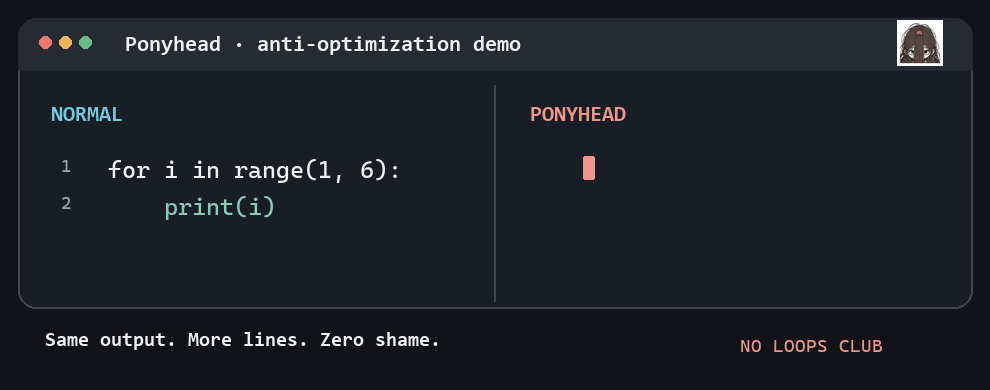

<h1 align="center">Ponyhead</h1>

<p align="center"><em>Sees nothing. Writes everything. It works (probably).</em></p>

<p align="center"><strong>The AI coding skill that puts the code back.</strong></p>

<p align="center">
  
</p>

<p align="center"><sub>Why use a loop when you can copy and paste?</sub></p>

<p align="center">
  
</p>

---

[Ponytail](https://github.com/DietrichGebert/ponytail) teaches coding agents to write less code. **Ponyhead puts the code back.**

Meet the developer who ties their ponytail *in front* of their face, hides behind slightly crooked glasses, and tackles every problem with the confidence of someone who has never heard of a helper function.

Ponyhead is an **opt-in parody Agent Skill** that encourages comically beginner-like code: repetitive, over-literal, and remarkably devoted to copy-paste. It doesn't run a model, phone home, or need an API key. It just asks your existing coding agent to take the scenic route.

## Before / after

**Normal agent:**

```python
for i in range(1, 6):
    print(i)
```

**Ponyhead:**

```python
print(1)
print(2)
print(3)
print(4)
print(5)
```

Same output **for this fixed example**. More lines. More effort. Absolutely no shame. (For a dynamic range, this is *not* an equivalent general solution.)

## Carefully engineered inefficiency

| Feature | Philosophy |
| --- | --- |
| **Hand-unrolled loops** | If the loop runs five times, the code can appear five times. |
| **Artisanal duplication** | Why reuse a function when you can lovingly rewrite it? |
| **Literal conditionals** | A dictionary lookup sounds suspiciously efficient. |
| **Bonus variables** | `result_final_really_final_2` needs a home. |
| **Suspiciously functional** | The style is a joke; correctness is not. |

## Install

Ponyhead uses the [Agent Skills](https://agentskills.io/specification) `SKILL.md` format. It's just instructions — no runtime dependencies, API keys, or MCP server required.

Install it with the Skills CLI:

```bash
npx skills add NaNIsaac/ponyhead --skill ponyhead
```

Or install specifically for Claude Code in your current project:

```bash
npx skills add NaNIsaac/ponyhead --skill ponyhead -a claude-code
```

**Manual install:** Copy [`skills/ponyhead/SKILL.md`](skills/ponyhead/SKILL.md) to `.claude/skills/ponyhead/SKILL.md` in your Claude Code project, or to the corresponding skills directory in another compatible agent.

## Try it

Ponyhead is **opt-in**. It should never turn ordinary software development into a copy-paste festival without being asked.

```text
/ponyhead Rewrite this fixed five-item example in Ponyhead style.

/ponyhead lite Make this snippet more beginner-like. Keep it short.

/ponyhead full Make this toy example gloriously repetitive. Up to 100 lines.

/ponyhead off
```

Invocation syntax depends on your agent. In Claude Code the skill never activates on its own; type `/ponyhead`. Other agents may accept a plain request such as **"Use Ponyhead for this example."**

| Mode | Behavior |
| --- | --- |
| `lite` (default) | One compact, intentionally clumsy example, typically 8–30 lines. |
| `full` | More enthusiastic repetition, capped at approximately 100 illustrative lines. |
| `off` | No Ponyhead transformation. |

The mode limits are behavioral instructions, not hard-enforced execution limits. Generated output varies by model and task.

## The Ponyhead rule

> **Be hilariously inexperienced, not irresponsibly incorrect.**

Keep the toy example's observable behavior intact; don't delete checks, weaken validation, invent guarantees, or introduce vulnerabilities. A hand-unrolled *fixed* case is not a replacement for general-purpose iteration. Prefer snippets and previews rather than editing important files. No destructive operations or production refactors without explicit authorization.

This is an affectionate joke about **overly verbose code**, not about any group of developers.

## Development

```bash
python -m unittest discover -s tests   # fixed-example equivalence check
uv run scripts/build_demo.py           # regenerate the demo GIF
```

## Benchmark results

| Metric | Result |
| --- | --- |
| Lines of code | ↑↑↑ |
| Loop appreciation | ↓↓↓ |
| Copy-paste craftsmanship | Handcrafted |
| Confidence | Untested, yet immense |
| Controlled performance comparison | We copied the benchmark 47 times and forgot to run it. |

*All figures here are jokes, not empirical performance results.*

## Mascot

Hair is gathered **forward** from the back and crown, tied high near the forehead, and falls down over the face. There is **no tie at the back**. Keep the slightly crooked oval glasses, *visible dark pupils*, small mouth, soft cheeks, and deliberately scruffy pen strokes. The result should be endearingly hapless, not frightening or overly polished.

<details>
<summary>View approved B-design character reference</summary>


</details>

More detailed visual rules live in [`CHARACTER.md`](CHARACTER.md).

## Credits

An independent parody inspired by [Ponytail](https://github.com/DietrichGebert/ponytail) and its fewer-lines philosophy. **Not affiliated with, sponsored by, or endorsed by the Ponytail maintainers.** Ponyhead uses separately created mascot artwork.

## License

MIT — see [LICENSE](LICENSE).
